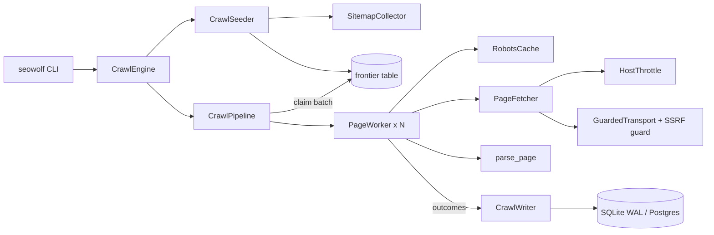

# Architecture

## Flow of one crawl

1. The CLI builds `CrawlOptions`, creates a project and a crawl row, and starts `CrawlEngine`.
2. On a fresh crawl, `CrawlSeeder` adds the start URL (or the URL list), reads `robots.txt` sitemaps and stores every sitemap file and URL.
3. `CrawlPipeline` claims batches from the `frontier` table, hands them to N workers and sends their outcomes to a single writer, so SQLite never sees competing writers.
4. `PageWorker` checks robots, fetches through `PageFetcher`, follows redirects hop by hop, parses HTML, and reserves newly discovered URLs in memory.
5. `CrawlWriter` stores pages, links, redirects, resources and new frontier rows, and marks claimed rows done, all in one transaction per batch.
6. Ctrl+C sets a stop flag. Claimed but unfinished rows stay `in_progress` and go back to `queued` on `seowolf crawl resume`.

## Safety at the connection layer

`GuardedTransport` swaps the network backend of the HTTP pool. Every new TCP connection resolves the host, rejects the connection if any address is private, loopback, link-local, CGNAT, multicast, reserved, IPv4-mapped or NAT64-embedded private, and then connects to the checked address. TLS still verifies the real host name. Because the check happens at connect time, redirects and DNS rebinding cannot slip past it.

## Storage

| Table | Holds |
|---|---|
| `projects` | Name, start URL, settings, branding, schedule |
| `crawls` | Status, mode, timings, totals, settings snapshot |
| `frontier` | Every URL to visit or check, its state and depth |
| `pages` | One row per crawled URL with status, head data and indexability |
| `links` | Every anchor, image, script and stylesheet reference |
| `redirects` | Full hop-by-hop chains, loops and errors |
| `resources` | Status of images, scripts, stylesheets and external links |
| `sitemap_files`, `sitemap_urls` | Every sitemap read and every URL listed |
| `robots_files` | The `robots.txt` seen for each origin |

Long URLs are indexed through a 40-character `url_key` hash so the schema works on Postgres without index size limits.
